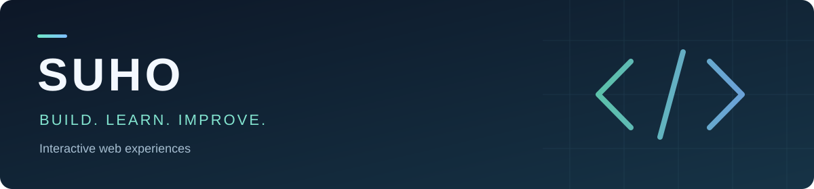

## Hi, I'm SUHO

I build interactive web experiences and learn by turning ideas into working projects. My current focus is React, TypeScript, and thoughtful user interfaces.

### What I'm working on

- Creating responsive interfaces with React and Tailwind CSS.
- Bringing pages to life with animation, audio, and small interactions.
- Improving project quality through testing, documentation, and practical fixes.

### Featured project

**[Birthday Template](https://github.com/suhanone/birthday-template)**

An anime-inspired birthday experience with animated cherry blossoms, music controls, an age display, and a live countdown.

`React` · `TypeScript` · `Tailwind CSS` · `Vite` · `Express`

[Live demo →](https://suhanone.github.io/birthday-template/) · [Explore the code →](https://github.com/suhanone/birthday-template) · [Run it locally →](https://github.com/suhanone/birthday-template#run-locally)

### CodeSandbox experiments

**[Drag Papers — interactive greeting](https://codesandbox.io/p/sandbox/birthday-74c7w3)**  
An earlier HTML, CSS, and JavaScript experiment with layered paper cards, personal messages, and music. Browse the sandbox to explore the implementation.

### Tools in my projects

| Frontend | Styling & interaction | Development |
| --- | --- | --- |
| React, TypeScript, HTML | Tailwind CSS, Framer Motion | Vite, Node.js, Express, Git |

---

**Build something. Test it. Make it better.**
